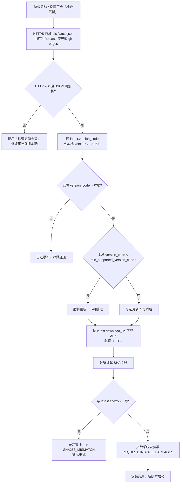

# OTA 更新与发布手册 · 《像素冒险》

本文覆盖从「改版本号」到「用户手机上完成更新」的完整链路，以及邮件通知与安全边界。
所有命令都在工程根 `D:\my-projects\games\game-4` 下执行，Python 用
`D:/apps/Python313/python.exe`（仅标准库，无需 pip install）。

---

## 1. 方案总览

游戏不内嵌任何更新服务器逻辑，只做一件事：**拉一份 JSON 清单，自己比对版本**。
清单是唯一的真相来源，APK 走 Release / CDN 分发。



要点：

- **清单先行**：APK 传完、`latest.json` 也传完，更新才对外可见。顺序反了会出现「清单说有新版，下载 404」。
- **校验在安装前**：SHA-256 不匹配就丢文件，绝不把半截 APK 交给系统安装器。
- **强制更新靠 `min_supported_version_code`**：低于它的客户端只能更新，不能继续玩。

---

## 2. 版本清单 `dist/latest.json` 字段表

结构固定为 `schema` / `game` / `package` / `latest` / `history` 五段，字段名一个都不能改
（游戏端 GDScript 按名解析）。

| 字段 | 类型 | 含义 | 谁生成 |
| --- | --- | --- | --- |
| `schema` | int | 清单结构版本，当前固定 `1`。将来结构变了就 +1，老客户端据此拒绝解析 | `release_manifest.py` 硬编码 |
| `game` | string | 游戏名，显示在更新弹窗标题。缺省 `像素冒险`，可 `--game` 覆盖 | `release_manifest.py`（`--game`） |
| `package` | string | Android 包名，客户端用它确认清单是发给自己的。缺省取 APK 内真实包名 | `release_manifest.py`（`--package` / aapt2） |
| `latest.version_name` | string | 展示用版本号，如 `1.0.1` | `--version-name` |
| `latest.version_code` | int | **比对用**整数版本号，必须严格递增 | `--version-code` |
| `latest.published_at` | string | 发布时间，UTC，格式 `YYYY-MM-DDTHH:MM:SSZ` | `--published-at`，缺省取当前 UTC |
| `latest.size_bytes` | int | APK 字节数（精确值，用于进度条与完整性初筛） | 脚本实测 |
| `latest.sha256` | string | APK 的 SHA-256，64 位小写 hex | 脚本分块计算（64KB） |
| `latest.min_supported_version_code` | int | 低于此 versionCode 的客户端必须强制更新 | `--min-version-code`，缺省 `1` |
| `latest.mandatory` | bool | 是否强制更新（提示语不可跳过） | `--mandatory` |
| `latest.changelog` | string[] | 更新说明，一条一行，弹窗逐条列出 | `--changelog`（可重复） |
| `latest.download_url` | string | APK 直链 = `{repo}/releases/download/{tag}/{文件名}` | 脚本拼接 |
| `latest.release_page` | string | 发布页 = `{repo}/releases/tag/{tag}`，给「查看详情」按钮 | 脚本拼接 |
| `history` | object[] | 历史版本数组，结构与 `latest` 完全相同，最多 10 条，新的在前 | 脚本自动累积 |

`history` 的作用：回滚提示、灰度对照、以及「用户从很老的版本跳上来时列出中间所有改动」。
它**不参与版本比对**——比对永远只看 `latest.version_code`。

生成示例：

```bash
D:/apps/Python313/python.exe scripts/release_manifest.py build \
  --apk build/pixel-adventure.apk \
  --version-name 1.0.1 --version-code 2 \
  --changelog "修复跳跃卡墙角" --changelog "新增 OTA 更新检查" \
  --repo https://github.com/<owner>/<repo> \
  --tag v1.0.1 \
  --published-at 2026-10-29T14:00:00Z \
  --out dist/latest.json
```

校验（发布前必跑，确认清单和 APK 对得上）：

```bash
D:/apps/Python313/python.exe scripts/release_manifest.py verify \
  --manifest dist/latest.json --apk build/pixel-adventure.apk
```

一致打印 `[PASS]` 返回 0；不一致打印 `[FAIL]` 并指出是 `sha256` 还是 `size_bytes` 不符，返回 1。

查看摘要：

```bash
D:/apps/Python313/python.exe scripts/release_manifest.py show --manifest dist/latest.json
```

---

## 2.5 客户端实现（游戏内 OTA 模块）

游戏内的更新逻辑全部在 `godot/scripts/ota/`，与游戏玩法完全解耦：面板关闭时游戏照常跑，
OTA 只负责「拉清单 → 比对 → 下载 → 校验 → 唤起安装器」。

| 文件 | 职责 | 关键接口 |
| --- | --- | --- |
| `ota_version.gd` | 版本号解析/比较、体积与时间格式化 | `parse` / `compare` / `is_newer` / `human_size` / `human_time` |
| `ota_manifest.gd` | 解析 `latest.json`，字段校验，下载地址白名单 | `from_json_text` / `is_allowed_download_url` |
| `ota_checker.gd` | HTTPS 拉清单（`HTTPRequest`），判四种结果 | `check` / `abort` / `is_busy` |
| `ota_downloader.gd` | 流式下载 APK 到 `user://ota/`，进度信号 | `start` / `cancel` / `is_running` |
| `ota_verifier.gd` | 分块 SHA-256 校验与判定 | `verify_file` / `file_sha256` / `file_size` |
| `ota_installer.gd` | 三级安装策略链 | `install` / `best_strategy` / `result_text` |
| `ota_log.gd` | JSONL 事件日志，脱敏 | `write` / `tail` / `clear` |
| `ota_config.gd` | 两层配置 + 当前版本读取 | `load_config` / `current_version` / `current_version_code` |
| `ota_panel.gd` | 更新弹窗（`CanvasLayer`，layer 120） | `show_available` / `show_progress` / `show_verifying` / `show_result` |
| `ota_manager.gd` | 状态机，串起上面所有环节 | `setup` / `check_silent` / `check_manual` / `is_busy` |

### 2.5.1 版本号从哪来

Godot 运行期**读不到 `export_presets.cfg`**，所以版本号走一个独立文件：

```json
// godot/version.json
{ "version_name": "1.0.1", "version_code": 2 }
```

发布时先改这个文件（`publish_release.py` 会校验它和 `export_presets.cfg` 的
`version/code`、`version/name` 是否一致），再导出 APK。**两边不一致是最常见的「更新永远弹不出来」原因**。

### 2.5.2 清单地址从哪来

`godot/ota_config.json`（打进 APK 的默认值）：

| 字段 | 默认值 | 说明 |
| --- | --- | --- |
| `manifest_url` | `""` | **空字符串 = 关闭自动检查**，便于开发期不弹窗 |
| `install_authority` | `com.pixelstudio.pixeladventure.fileprovider` | 走 FileProvider 安装时用的 authority |
| `check_on_start` | `true` | 启动即静默检查；`false` 则只在设置页手动触发 |
| `timeout_sec` | `10.0` | 拉清单超时 |
| `game_name` | `像素冒险` | 弹窗标题用 |
| `package_name` | `com.pixelstudio.pixeladventure` | 与清单 `package` 比对 |

`user://ota_config.json` 存在时**逐字段覆盖**上面这份，用于线上临时切清单地址而不重新出包
（调试用；正式发布建议改 `res://ota_config.json` 后重打包）。

### 2.5.3 安装策略链（Android 7+ 的现实约束）

`ota_installer.gd` 按顺序尝试，任一成功即止：

1. **PLUGIN**：`Engine.has_singleton("OtaInstaller")`。真正的 FileProvider 安装需要 Java 侧插件，
   本工程**未内置**，所以这条通常是空的——这是已知限制，不是 bug。
2. **AM_INTENT**：`am start -a android.intent.action.VIEW -d file://… -t application/vnd.android.package-archive -f 0x10000001`。
   在没有插件的情况下，多数定制 ROM 会拒绝 `file://`（`FileUriExposedException`），此时落到第 3 步。
3. **BROWSER**：`OS.shell_open(release_page)`，让用户在浏览器里手动下载安装。
   **这是当前工程在真机上的实际路径**，弹窗里「手动下载」按钮走的也是它。

因此「检测 → 下载 → 校验」全自动，「安装」一步在无插件时是**半自动**：跳到发布页由用户完成。
要变成全自动，需要补一个 Android 插件（`FileProvider` + `ACTION_INSTALL_PACKAGE` Intent）。

### 2.5.4 异常与提示文案对照

| 场景 | 判定 | 用户看到 | 后续 |
| --- | --- | --- | --- |
| 清单 404 / 超时 / DNS 失败 | `failed(reason)` | 更新失败：网络错误 | 当前版本继续可用 |
| 清单 JSON 非法 / 字段缺失 / sha 位数不对 | `Result.BAD_MANIFEST` | 更新失败：清单格式错误 | 同上，日志记原因 |
| 清单地址是 http 非回环 | `BAD_MANIFEST` | 更新失败：下载地址必须使用 https | 拒绝明文分发 |
| 远端版本不新 | `Result.UP_TO_DATE` | 不弹窗（手动检查时提示已最新） | — |
| 本地 code < `min_supported_version_code` | `Result.UNSUPPORTED` | 强制更新，不可跳过 | 只能更新或退出 |
| 下载中断 | `Fail.NETWORK` | 更新失败：下载中断 | 重试 / 手动下载 / 取消 |
| 磁盘写入失败 | `Fail.DISK` | 更新失败：无法写入下载文件 | 同上 |
| SHA-256 不符 | `Verdict.MISMATCH` | 校验失败：哈希不匹配（文件已删除） | 当前版本未受影响 |
| 非 Android 平台 | `Result.NOT_ANDROID` | 未找到可用的安装器，已改为手动下载 | 跳发布页 |
| 用户取消 | `Fail.ABORTED` / `Result.USER_CANCELLED` | 静默关闭 | — |

### 2.5.5 日志

`user://ota_log.jsonl`，最多保留 200 行，每行 `{"ts","event","detail"}`。
脱敏规则：键名含 `pass` / `token` / `secret` / `key` / `auth` 的值一律写 `***`；
URL 的查询串截断成 `?***`；清单地址只记 host。
在 Android 上取日志：`adb shell run-as com.pixelstudio.pixeladventure cat files/ota_log.jsonl`。

### 2.5.6 手动检查入口

除了启动时的静默检查，游戏内还有一条手动通道：

| 触发方式 | 键位 | 行为 |
| --- | --- | --- |
| 手动检查更新 | `U` | 任意游戏状态下按 U → `OtaManager.check_manual()`；面板打开时游戏逻辑冻结，关闭后原状态继续 |

实现位置：`godot/scripts/input_hub.gd` 的 `CHECK_UPDATE` 动作（绑定 `KEY_U`）、
`godot/scripts/main.gd` 的 `_process()` 开头（在 `_ota_busy` 早退之后、状态机之前）、
标题界面按键说明表（`godot/scripts/ui.gd` 的 `_build_title()`，第 6 行「U / 检查更新」）。

与静默检查的差别只有一条：**手动检查失败也会弹面板**（静默检查失败只写日志），
因为玩家主动触发了就必须给反馈。两者共用同一套 `_begin_check()`。

### 2.5.7 界面截图

| 状态 | 截图 |
| --- | --- |
| 发现新版本（版本号 / 大小 / 发布时间 / SHA-256 / 更新说明 / 三个按钮） | `docs/shots/ota_available.png` |
| 下载中（进度条 + 已下载/总量 + 取消） | `docs/shots/ota_progress.png` |
| 更新失败（原因 + 当前版本未受影响 + 重试/手动下载/取消） | `docs/shots/ota_failed.png` |
| 标题界面按键表（末行「U / 检查更新」） | `docs/shots/ota_manual_key.png` |

---


## 3. 发布流程（分步可执行）

### 步骤 0 · 确认导出预设

`godot/export_presets.cfg` 里的 Android 预设（`[preset.2]`）关键字段：

```ini
name="Android"
platform="Android"
export_path="../build/pixel-adventure.apk"
version/code=2
version/name="1.0.1"
package/unique_name="com.pixelstudio.pixeladventure"
package/name="像素冒险"
permissions/custom_permissions=PackedStringArray(
    "android.permission.INTERNET",
    "android.permission.REQUEST_INSTALL_PACKAGES")
```

（`export_presets.cfg` 实际是单行写法，这里换行只为可读。）

> **注意**：本手册与脚本**不会修改** `godot/` 下任何文件。改版本号必须手工编辑这一处，
> 同时同步 `godot/version.json`（客户端运行期读的是它，不是 preset）。
>
> **权限是 OTA 的前提**：没有 `INTERNET` 拉不到清单，没有 `REQUEST_INSTALL_PACKAGES`
> 系统不会给安装界面。这两条已加在 Android 预设里，新工程记得照抄。

### 步骤 1 · 改版本号（手工）

**两处都要改，且必须一致**：

1. `godot/export_presets.cfg` 的 Android 预设段：

```ini
version/code=3
version/name="1.1.0"
```

2. `godot/version.json`（客户端比对用的真值）：

```json
{ "version_name": "1.1.0", "version_code": 3 }
```

规则：`version_code` **只增不减**，每次发布 +1；`version_name` 给人看，建议语义化 `主.次.修订`。
改完确认两处一致：

```bash
grep -n 'version/code\|version/name' godot/export_presets.cfg
cat godot/version.json
```

> **只改 preset 不改 `version.json`** 的后果：APK 里 versionCode 是新的，但游戏自报版本还是旧的，
> 于是每次启动都弹「发现新版本」，下载安装完还是弹——死循环。这是最容易踩的坑。
> `publish_release.py` 会比对这两处并打 WARNING，但不会替你改。

### 步骤 2 · 一条命令导出 + 生成清单

```bash
D:/apps/Python313/python.exe scripts/publish_release.py \
  --version-name 1.0.1 --version-code 2 \
  --repo https://github.com/<owner>/<repo> \
  --tag v1.0.1 \
  --changelog "修复跳跃卡墙角" --changelog "新增 OTA 更新检查"
```

这个脚本会做四件事：

1. **预检**：Godot 可执行文件、工程目录、`export_presets.cfg` 里的版本号是否已改（没改会 WARNING，但不阻断）；
2. **导出**：先 `--headless --path godot --import` 重新导入资源，再 `--export-debug Android ../build/pixel-adventure.apk`；
3. **清单**：直接 `import` 复用 `release_manifest.build_manifest()` 生成 `dist/latest.json`（不是复制一份实现）；
4. **打印**：把人工要做的 git / Release 步骤打成清单。

常用开关：

| 开关 | 作用 |
| --- | --- |
| `--skip-export` | 跳过导出，直接用现有 `build/pixel-adventure.apk` 重算清单 |
| `--dry-run` | 只打印将执行的命令，不真跑、不写清单 |
| `--apk <path>` | 换 APK 路径 |
| `--out <path>` | 换清单输出路径 |
| `--mandatory` | 标记强制更新 |
| `--min-version-code <n>` | 设置最低可运行版本 |

> 脚本**绝不执行任何 git 命令**（本工程当前还不是 git 仓库）。它只把命令打印出来给你复制。

### 步骤 3 · 校验

```bash
D:/apps/Python313/python.exe scripts/release_manifest.py verify \
  --manifest dist/latest.json --apk build/pixel-adventure.apk
```

必须看到 `[PASS]` 再往下走。

### 步骤 4 · 初始化仓库并提交 APK（手工，首次才需要 init）

```bash
git init
git branch -M main
git remote add origin https://github.com/<owner>/<repo>.git

git add build/pixel-adventure.apk
git add dist/latest.json
git add .gitignore .env.example docs/OTA.md
git add scripts/release_manifest.py scripts/publish_release.py scripts/send_release_email.py
git commit -m "release: v1.0.1 (code 2)"
```

> APK 约 29MB。如果你不想让它进仓库历史，可以只把 `latest.json` 提交，APK 直接拖到 Release 资产里
> （`.gitignore` 已按「APK 不进仓库」的偏好写了 `dist/*.apk`，如需入库请 `git add -f`）。

### 步骤 5 · 打 tag 并推送

```bash
git tag -a v1.0.1 -m "v1.0.1 (code 2)"
git push -u origin main
git push --tags
```

### 步骤 6 · 建 GitHub Release 并上传 APK

1. 打开 `https://github.com/<owner>/<repo>/releases/new?tag=v1.0.1`
2. Title 填 `v1.0.1`
3. 把 `build/pixel-adventure.apk` 拖进 Assets
4. 发布后确认这个地址能直接下到文件：
   `https://github.com/<owner>/<repo>/releases/download/v1.0.1/pixel-adventure.apk`

**文件名必须和清单里 `download_url` 的最后一段完全一致**，否则游戏下载会 404。

### 步骤 7 · 让游戏能拉到 `latest.json`

三选一：

| 方案 | 清单地址 | 适用 |
| --- | --- | --- |
| a) Release 资产 | 把 `dist/latest.json` 也作为资产上传，游戏从「最新 Release 的资产列表」取 | 最简单，但客户端要先查 API |
| b) gh-pages | 提交到 `gh-pages` 分支根目录 → `https://<owner>.github.io/<repo>/latest.json` | 推荐：URL 固定不变，CDN 加速 |
| c) 任意 HTTPS 静态托管 | 对象存储 / CDN / 自有服务器 | 有自己域名时 |

无论哪种，**URL 必须固定**，因为它是编译进游戏里的常量。

### 步骤 8 · 邮件通知（可选）

见第 4 节。

---

## 4. 邮件通知

脚本：`scripts/send_release_email.py`。**凭据只从环境变量读，绝不硬编码、绝不入库。**

### 4.1 环境变量清单

| 变量 | 必填 | 缺省 | 说明 |
| --- | --- | --- | --- |
| `OTA_SMTP_HOST` | ✅ | — | SMTP 服务器地址，如 `smtp.qq.com` |
| `OTA_SMTP_PORT` | | `587` | 端口。587=STARTTLS，465=SSL，25=明文 |
| `OTA_SMTP_SECURITY` | | `starttls` | `starttls` / `ssl` / `none` |
| `OTA_SMTP_USER` | | — | 认证用户名。**留空则跳过登录**（本地测试中继用） |
| `OTA_SMTP_PASS` | | — | 认证密码。强烈建议用「应用专用密码」而非主密码 |
| `OTA_SMTP_FROM` | | = `OTA_SMTP_USER` | 发件人地址 |
| `OTA_SMTP_TO` | ✅ | — | 收件人，多个用英文逗号分隔 |
| `OTA_MAIL_MAX_ATTACHMENT_MB` | | `20` | 附件上限（MB）。超过则不发附件，正文只放下载链接 |

### 4.2 `.env` 用法

`.env.example` 是模板（**不含任何真实凭据**），复制成 `.env` 填值；`.env` 已在 `.gitignore` 里。

本项目脚本**不自动读取 `.env`**（只用标准库，不引入 python-dotenv），需要先把变量导进环境：

```powershell
# PowerShell：从 .env 读入当前进程
Get-Content .env | Where-Object { $_ -match '^OTA_' } | ForEach-Object {
    $k,$v = $_ -split '=',2; [Environment]::SetEnvironmentVariable($k,$v,'Process')
}
D:/apps/Python313/python.exe scripts/send_release_email.py --manifest dist/latest.json
```

```bash
# bash
set -a; . ./.env; set +a
D:/apps/Python313/python.exe scripts/send_release_email.py --manifest dist/latest.json
```

### 4.3 命令

```bash
# 带附件（默认）
D:/apps/Python313/python.exe scripts/send_release_email.py \
  --manifest dist/latest.json --apk build/pixel-adventure.apk

# 只发链接，不带附件
D:/apps/Python313/python.exe scripts/send_release_email.py \
  --manifest dist/latest.json --no-attachment

# 演练：不连服务器、不发邮件，只打印正文
# （配置缺失 / 附件超限这类事件仍会写进 build/logs/，方便排查）
D:/apps/Python313/python.exe scripts/send_release_email.py \
  --manifest dist/latest.json --dry-run

# 自定义重试次数（缺省 2 次重试 = 最多 3 次尝试）
D:/apps/Python313/python.exe scripts/send_release_email.py \
  --manifest dist/latest.json --retries 3
```

邮件是 **纯文本 + 简单 HTML 双版本**，正文含：游戏名、版本号、更新时间、更新说明（逐条）、
APK 下载链接、文件大小（人类可读，如 `28.9 MB`）、SHA-256。

### 4.4 附件大小限制

| 情况 | 行为 |
| --- | --- |
| APK ≤ `OTA_MAIL_MAX_ATTACHMENT_MB` | 作为附件随信发出 |
| APK > 上限 | **不发附件**，正文只放下载链接，日志记 `ATTACHMENT_TOO_LARGE` |
| `--no-attachment` | 主动不发附件 |
| 本地 APK 不存在 | 降级为只发链接 |

> 当前 APK 约 **28.9 MB**，而多数邮箱单封上限是 20–25MB。所以默认配置下**会走「只发链接」分支**——
> 这是预期行为，不是 bug。想真发附件就把 `OTA_MAIL_MAX_ATTACHMENT_MB` 调大，但要确认服务商允许。

### 4.5 失败码与事件

**退出码**

| 码 | 含义 | 是否重试 |
| --- | --- | --- |
| `0` | 成功（含「附件超限降级为只发链接」） | — |
| `2` | 认证失败（`SMTPAuthenticationError`） | **不重试**（重试没用） |
| `3` | 连接 / 发送最终失败（重试耗尽） | 已按 `--retries` 指数退避重试 |
| `4` | 配置缺失 / 清单不可读 | 不重试 |

**日志事件**（JSON Lines，`build/logs/mail-YYYYMMDD.jsonl`，每行 `{"ts","event","detail"}`）

| 事件 | 触发条件 |
| --- | --- |
| `SENT` | 发送成功 |
| `ATTACHMENT_TOO_LARGE` | 附件超限，已降级为只发链接 |
| `CONNECT_FAILED` | 连接阶段失败（DNS / 拒绝连接 / 超时） |
| `AUTH_FAILED` | 认证失败 |
| `SEND_FAILED` | 发送阶段失败（收件人被拒 / 发件人被拒 / 其它 SMTP 错误） |
| `CONFIG_ERROR` | 配置缺失或清单不可读 |

重试策略：指数退避，`1.5s → 3.0s → 6.0s …`，最多 `--retries` 次。

日志安全：**密码永远不会出现在日志里**（写入前会把 `OTA_SMTP_PASS` 的值替换成 `***`），
收件人邮箱脱敏成 `a***@example.com`。

---

## 5. 安全说明

### 5.1 为什么 SMTP 凭据不能进 APK、不能进仓库

- **进 APK = 公开**。APK 是可以被任何人下载、解包、`strings`/反编译的。写进 APK 的字符串等于公开发布。
  一旦有人拿到你的 SMTP 账号密码，就能用你的身份发任意邮件（钓鱼、诈骗），你的域名/邮箱会被拉黑。
- **进仓库 = 永久泄露**。git 历史是不可变的：即使后来删掉文件，历史提交里仍然能翻出来。
  GitHub 上有专门的爬虫实时扫描新提交里的密钥，泄露通常在几分钟内被利用。
- 所以本方案的设计是：**凭据只存在于发送机的一次性环境变量里**，脚本本身、样例文件、日志、输出里都不出现。

### 5.2 传输与分发

| 项 | 要求 | 原因 |
| --- | --- | --- |
| `latest.json` | **必须 HTTPS** | 明文 HTTP 下，中间人可以篡改清单，把 `download_url` 指向自己的恶意 APK |
| APK 下载 | **必须 HTTPS** | 同上，且大文件更易被劫持注入 |
| SMTP | 优先 `starttls` / `ssl` | 明文 SMTP 会把密码以 base64 形式暴露在链路上 |

### 5.3 SHA-256 能防什么、不能防什么

**能防**：下载过程中被截断、被中间人替换单个字节、CDN 缓存了旧/坏文件、磁盘写入错误。
客户端算出的摘要与清单不符就丢弃文件，不会把坏包交给系统安装器。

**不能防**：**清单本身被替换**。如果攻击者能同时改 `latest.json`（比如你的 gh-pages 被拿下、
或者 CDN 被投毒），他可以把 `download_url` 和 `sha256` 一起换成自己的，校验依然"通过"。
SHA-256 只保证「文件与清单一致」，不保证「清单是真的」。

### 5.4 后续增强：签名清单

要真正解决「清单被换」，需要让清单**自带来源证明**，常见做法：

1. **离线签名清单**：发布机用私钥对 `latest` 段做 Ed25519 签名，签名写进清单的 `signature` 字段；
   公钥**硬编码进 APK**。客户端验签通过才信任清单内容。
2. **密钥分层**：签名私钥离线保存（不在这台开发机上），只用于发版；泄露影响面可控、可轮换。
3. **配合 Android 应用签名**：系统安装器本身会校验 APK 签名，所以「换包」还必须同时伪造应用签名，
   门槛更高。两层校验叠加后，攻击成本显著上升。

在实现签名清单之前，务实的做法是：**清单托管在你自己可控的 HTTPS 域名下，并开启 2FA**。

---

## 6. 故障排查表

| 症状 | 原因 | 处理 |
| --- | --- | --- |
| 游戏提示「检查更新失败」，日志 404 | 清单 URL 写错；或 `latest.json` 还没上传；或 gh-pages 分支没生效 | 用浏览器直接打开清单 URL 确认能返回 JSON；确认文件名是 `latest.json`（不是 `latest.json.txt`）；gh-pages 推送后等 1–2 分钟 |
| 更新了版本但游戏一直提示「已是最新」 | `version_code` 没递增（还是旧值）；或清单没更新（CDN 缓存）；或客户端读的是缓存 | 查 `dist/latest.json` 的 `latest.version_code` 是否大于 APK 内真实值；`release_manifest.py build` 会打印 WARNING 提示 aapt2 读到的真实版本号；给清单 URL 加 cache-busting 或设短 TTL |
| 下载完提示 sha256 不匹配 | APK 被重新导出但清单没重算；或 Release 上的是旧 APK；或下载被截断 | 重新跑 `release_manifest.py build` 生成新清单，再跑 `verify` 确认 `[PASS]`；确认 Release 资产是最新上传的那份 |
| 邮件报认证失败（退出码 2） | 密码错；用的是主密码而非应用专用密码；服务商要求 OAuth；`OTA_SMTP_SECURITY` 与端口不匹配（如 465 却填 starttls） | QQ/163 邮箱需在后台开启 SMTP 并生成「授权码」当密码；465 端口配 `ssl`，587 配 `starttls`；Gmail 需应用专用密码 |
| 邮件里没有附件，只有链接 | APK 超过 `OTA_MAIL_MAX_ATTACHMENT_MB`（默认 20MB，而 APK 约 29MB） | 这是预期行为。要发附件就调大上限并确认服务商允许；否则接受「只发链接」 |
| Release 里的 APK 不是最新 | 上传了旧文件；或 tag 指到了旧 commit；或文件名不一致导致浏览器缓存 | 看 Release 资产的上传时间与大小，与 `latest.size_bytes` 对比；`release_manifest.py verify` 只能校验本地 APK，远端要手工比对大小/时间；必要时删掉旧资产重传 |
| `publish_release.py` 报「找不到 Godot」 | `D:/apps/Godot/4.7.2/...console.exe` 路径不对 | 用 `--godot <path>` 指定，或加 `--skip-export` 直接用现有 APK |
| 导出的 APK 里没有新加的脚本/素材 | 导出前没跑 `--import`，资源没进 pck | `publish_release.py` 已内置先 import 再 export；手工导出时要自己先跑一次 `--headless --path godot --import` |
| 导出成功但 APK 体积异常小 | `export_presets.cfg` 的 `exclude_filter` 误把 `scripts/*` 排除了 | 检查 Android 预设的 `exclude_filter`，不要包含 `scripts/*` |

---

## 7. 已知限制

1. **没有真正的自动更新**。游戏只负责「检查 + 下载 + 校验 + 唤起安装器」，安装动作由系统完成，
   用户仍需点确认。要实现静默更新需要系统级权限（如设备管理员 / 系统应用），普通 APK 做不到。
   本工程在无插件时连「唤起安装器」都会退化为跳发布页（见 2.5.3）。
2. **清单无签名，信任锚是 HTTPS**。如 5.3 所述，清单被替换时 SHA-256 校验无效。签名清单尚未实现。
3. **`history` 只是记录，不参与逻辑**。回滚需要人工改清单（把旧版本重新写进 `latest`），
   没有自动回滚机制，也没有灰度/分批发布。
4. **版本比对只认 `version_code`**。`version_name` 仅用于展示，写成什么都行，但别指望它参与比较。
5. **清单 URL 编译进游戏**。换托管位置必须重新出包，不能远程改。
6. **邮件发送不保证送达**。SMTP 只是投递，进不进收件箱取决于对方服务商的反垃圾策略；
   脚本能确认的只有「SMTP 服务器接受了这封信」，不代表用户收到了。
7. **APK 约 29MB，超过多数邮箱附件上限**。默认配置下邮件只发链接，这是设计上的取舍，
   不是缺陷；真要发附件请自建大附件通道或换用下载页。
8. **`publish_release.py` 不执行 git**。这是刻意的（工程当前非 git 仓库，且避免脚本误改仓库状态）。
   git 步骤必须人工执行，脚本只保证打印出来的命令是对的。
9. **没有 CI 集成**。整条链路是本地手工触发的，没有 GitHub Actions 自动出包。
10. **邮件测试不覆盖真实 SMTP**。`scripts/tests/test_ota_tooling.py` 全部 mock 掉 SMTP，
    真实服务商的兼容性（TLS 版本、限流、反垃圾）只能靠实发一次验证。
    OTA 侧则**已覆盖真实 HTTP**：`godot/ota_test.gd` 打本地 `127.0.0.1:8791` 真发请求、真落盘、真算 SHA-256。
11. **未在真机验证安装跳转**。本机无模拟器、`adb devices` 为空，所以「下载 → 校验」在桌面端实测通过，
    「唤起系统安装器」这一步只能靠代码路径与错误文案覆盖，未做过真机点击验证。
12. **未内置 FileProvider 插件**。见 2.5.3：真机上会落到「跳浏览器手动下载」，
    要全自动安装必须补 Android 插件（`FileProvider` + `ACTION_INSTALL_PACKAGE`），本工程未做。
13. **`ota_config.json` 的 `manifest_url` 默认是空串**。这是刻意的安全默认值：不填就不联网检查。
    正式发布必须把它改成真实 HTTPS 清单地址并重新出包。
